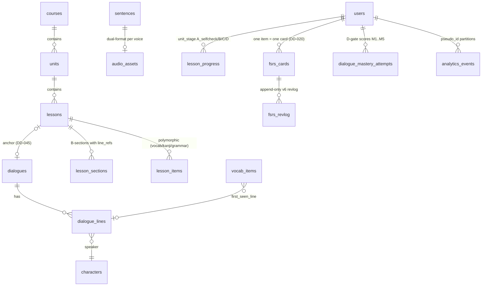

# Data Architecture — HANASO

> **خلاصهٔ فارسی:** سه شِما — `content` (محتوای منتشرشده، بازسازی‌پذیر از ریپو)، `app` (دادهٔ کاربر، هرگز با publish بازنویسی نمی‌شود)، `analytics` (رویدادها/رولآپ/audit). همهٔ PKها uuidv7؛ زمان‌ها timestamptz؛ مهاجرت فقط با فایل SQL کنترل‌شده (expand-contract). مرجع کامل: KB `database-architecture.md` و `dialogue-content-schema.md`.

## ERD — core entities (summary)

## Schema ownership

| Schema         | Owner module                    | Rebuildable?                     | Notes                                                                             |
| -------------- | ------------------------------- | -------------------------------- | --------------------------------------------------------------------------------- |
| `content`      | content (pipeline)              | Yes — republish from repo        | YAML in git is the source of truth (ADR-008)                                      |
| `app`          | each domain module (its tables) | No — user data                   | `fsrs_revlog` is append-only (REVOKE UPDATE/DELETE; voiding via SECURITY DEFINER) |
| `analytics`    | analytics                       | Partially (rollups re-derivable) | Monthly partitions; `admin_audit_log` chain-hashed, 24-month retention            |
| pg-boss schema | queue infra                     | Yes                              | —                                                                                 |

## Key conventions (from KB — binding)

- PKs: `uuid DEFAULT uuidv7()`; times: `timestamptz`; enums: `text + CHECK`; read-only structured data: JSONB.
- `search_key` = **STORED** generated column via `fold_search_key()` (NFKC + katakana-fold + ー-normalization).
- **`completed` vs `understood`:** `lesson_progress.unit_stage` tracks A_selfcheck/B/C/D; unit status `understood` is set **only** from the stage-D mastery attempt result (`dialogue_mastery_attempts.outcome='passed'`, revision-bound). Details: `docs/domain/DOMAIN-MODEL.md`.
- DB roles: `app_rw` (write app/read content) · `content_rw` · `migrator`. No agent ever touches production DB directly.

## Migration policy

- SQL files in `drizzle/` generated by `drizzle-kit generate`, PR-reviewed, applied via one-shot `docker compose run --rm migrate` **on a direct connection (bypassing PgBouncer)**.
- Every breaking change follows **expand-contract** with a compatibility window ≥ 1 full release; big indexes use `CREATE INDEX CONCURRENTLY`.
- 7-item pre-merge checklist incl. staging rehearsal on a restored copy (KB database-architecture §migrations).

## Retention & privacy (ADR-016 / DD-056)

Raw events TTL 12 months (OQ-021 gate) · daily_user 36 mo · rollups unlimited · quarantine 90 d · audit log 24 mo · user deletion cascade ≤30 days across pseudo-named tables + re-aggregation. PII blacklist CI-gated; outputs k≥10 only.
