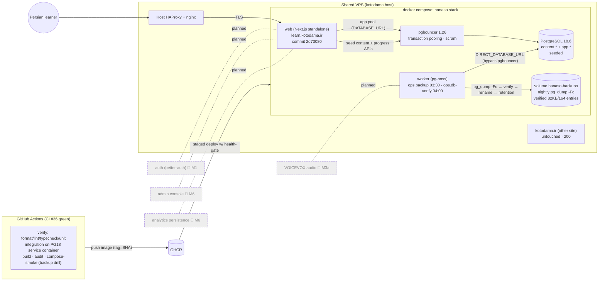

# HANASO Architecture Map — Real State (TASK-OPS-01 §۵)

> **Date:** 2026-11-02/03 · **Scope:** what EXISTS today, verified by code inspection in `apps/web/`, `infra/`, and live production checks. Not the future architecture.
> **Legend:** ✅ exists & tested · 🟡 exists, partially wired · 🔴 does not exist (even if documented in KB)

## 1. Layer-by-layer reality

| Layer                                | Reality today                                                                                                                                                                                                                                                                                              | Code location                                                          | Connected to                                    | Mock vs real           | Tested                                                                   | Deployed                              | Designed yet?                                                  |
| ------------------------------------ | ---------------------------------------------------------------------------------------------------------------------------------------------------------------------------------------------------------------------------------------------------------------------------------------------------------- | ---------------------------------------------------------------------- | ----------------------------------------------- | ---------------------- | ------------------------------------------------------------------------ | ------------------------------------- | -------------------------------------------------------------- |
| **Frontend (Next.js 16 App Router)** | 8 page routes, React Compiler on, RTL DirectionProvider, 9 shadcn/Radix components, FuriganaText, self-hosted fonts (1.73MB budget gate)                                                                                                                                                                   | `apps/web/src/app/**`, `src/components/**`, `src/styles/tokens.css`    | API routes                                      | real UI                | unit (tokens-gate, buttons, furigana) + browser probe (Chromium/Firefox) | ✅ live                               | ✅                                                             |
| **API layer**                        | 6 route handlers with uniform ok/fail envelope + zod validation: health, ready, attempts, dialogues/[slug], events, progress                                                                                                                                                                               | `apps/web/src/app/api/**/route.ts`                                     | DB repos (when DATABASE_URL set) else in-memory | real                   | integration (routes.spec on PG18)                                        | ✅ live                               | ✅                                                             |
| **Authentication**                   | 🔴 NONE — fixed `poc-user` principal (dev-only constant)                                                                                                                                                                                                                                                   | `src/lib/poc/principal.ts`                                             | —                                               | placeholder by design  | n/a                                                                      | n/a                                   | ✅ designed (better-auth, KB ADR) — planned M1                 |
| **Authorization / RBAC**             | 🔴 NONE (no roles, no admin)                                                                                                                                                                                                                                                                               | —                                                                      | —                                               | —                      | —                                                                        | —                                     | 🟡 KB blueprint (ADR-017 admin) only                           |
| **Database**                         | PostgreSQL 18.6 + Drizzle ORM; 2 schemas: `content.*` (characters/dialogues/dialogue_lines/lessons) + `app.*` (dialogue_mastery_attempts/lesson_progress); uuidv7() PKs; migration 0000 committed                                                                                                          | `apps/web/db/schema/**`, `db/migrations/`, `src/db/client.ts`          | PgBouncer (app) / direct (migrations, dump)     | real                   | ✅ 32 integration tests on real PG18                                     | ✅ live (prod + CI service container) | ✅                                                             |
| **Repositories**                     | 2 Postgres repositories (attempts w/ 23505-retry loop, progress upsert A→D) + engine-shaped in-memory stores for dev (switch by DATABASE_URL)                                                                                                                                                              | `src/db/repositories/**`, `src/lib/poc/stores.ts`                      | modules/mastery, modules/progress               | real + dev fallback    | ✅ integration (repositories.spec incl. forced collision)                | ✅                                    | ✅                                                             |
| **Background jobs**                  | pg-boss 12 in polling mode; 2 cron schedules: `ops.backup` (03:30 Asia/Tehran) + `ops.db-verify` (04:00); job history table for observability                                                                                                                                                              | `src/worker/**` (main/backup/verify/schedules)                         | PostgreSQL direct                               | real                   | ✅ integration (worker.spec: start/queue/schedule/history)               | ✅ worker container live              | ✅                                                             |
| **File storage**                     | 🔴 none beyond DB (audio = generated WAVs in `public/poc-audio/`, gitignored; NOT generated in prod build — known debt D-01)                                                                                                                                                                               | `scripts/generate-placeholder-audio.mjs`                               | —                                               | placeholder            | manifest sidecar + unit-pinned hash                                      | 🟡 files 404 in prod (D-01)           | 🟡 VOICEVOX dual-encode pipeline designed (ADR-009), not built |
| **Audio pipeline**                   | module with voice profiles (F0 per speaker), browser playback backend, error taxonomy (MissingFileError etc.); placeholder = sine-synthesis WAV                                                                                                                                                            | `src/modules/audio/**`                                                 | dialogue player UI                              | placeholder            | unit (audio-errors, playback-engine T1 real-timer probe)                 | 🟡 (runs silent in prod)              | ✅ designed (ADR-009) — build in M3a                           |
| **Learning engine**                  | dialogue (playback engine, content schema), character (animation contract per ADR-018), fsrs (context wiring, ts-fsrs), mastery (scoring + understood gate), practice (generator/checker 6 types), progress (A→D state machine) — all PoC-grade, one unit of content                                       | `src/modules/**`                                                       | API + repos                                     | real code, PoC content | ✅ unit suites per module + slice integration                            | 🟡 deployed as PoC                    | ✅ contracts; scale-out in M2/M3b                              |
| **Content registry**                 | seed with deterministic uuidv5 ids (characters/dialogue/lines/lesson) — single dialogue `cafe-morning-01`; full content-as-code registry 🔴                                                                                                                                                                | `src/db/seed.ts`, `src/db/content-map.ts`, `src/db/ids.ts`             | repos (id resolution)                           | real, minimal          | ✅ integration (migrate-seed.spec idempotency)                           | ✅ seeded in prod                     | 🟡 ADR-008 pipeline designed, not built                        |
| **Learning analytics**               | 🔴 event sink only: `POST /api/events` → in-memory store (ADR-016-shaped `{name, props}`); no persistence, no dashboards                                                                                                                                                                                   | `src/app/api/events/route.ts`, `src/lib/poc/event-store.ts`            | —                                               | PoC                    | unit (envelope)                                                          | 🟡 deployed as PoC sink               | ✅ designed (ADR-016) — build in M6                            |
| **Admin**                            | 🔴 nothing in this repo (KB has full blueprint + design proofs)                                                                                                                                                                                                                                            | —                                                                      | —                                               | —                      | —                                                                        | —                                     | 🟡 blueprint ready (ADR-017, admin proofs)                     |
| **Monitoring**                       | `/api/health` (commit/version/uptime) + `/api/ready` (real DB check w/ latency, fail-closed 503, no connection-detail leak); no external uptime monitor                                                                                                                                                    | `src/app/api/health/route.ts`, `ready/route.ts`, `src/db/readiness.ts` | DB                                              | real                   | ✅ integration + live checks (this audit)                                | ✅                                    | ✅ (Gatus planned later)                                       |
| **Deployment**                       | Docker (multi-stage, digest-pinned pg tools) → GHCR; compose stack: web/worker/postgres(18-alpine pinned)/pgbouncer(1.26, transaction pooling, scram) on shared VPS behind host HAProxy/nginx + TLS; staged deploy script w/ health-gate + rollback; CI runs real compose-smoke incl. backup/restore drill | `infra/docker/**`, `infra/deploy/**`, `.github/workflows/ci.yml`       | GHCR, VPS                                       | real                   | ✅ CI job green (compose-smoke)                                          | ✅ live https://learn.kotodama.ir     | ✅                                                             |

## 2. Runtime topology (Mermaid — as deployed today)

## 3. What is explicitly NOT there yet (despite KB docs)

Kanji reading/writing, speaking practice & recording, FSRS scheduling sessions, auth, admin, analytics persistence, offsite backups (S3), real VOICEVOX audio, real character art, email/SMS, payments. All exist as **KB research/design documents only** — tracked in [`../roadmap/MASTER_ROADMAP.md`](../roadmap/MASTER_ROADMAP.md).

## 4. Key decisions encoded in this architecture (ADR index)

| ADR (repo `docs/adr/`)                          | Decision                                                                                                                                    |
| ----------------------------------------------- | ------------------------------------------------------------------------------------------------------------------------------------------- |
| ADR-001/002                                     | Modular monolith product repo; `apps/web` single deployable, workspace shell                                                                |
| ADR-003                                         | Preview deployment on shared VPS (isolation rules)                                                                                          |
| ADR-005                                         | CI baseline incl. real PG18 integration + compose-smoke                                                                                     |
| ADR-006                                         | Two-layer agent skills (16 internal SKL + 12 external EXT, vendored & pinned)                                                               |
| KB ADR-004/005/006/009/016/017/018 (referenced) | Tailwind+shadcn · PostgreSQL+Drizzle · better-auth (M1) · audio pipeline (M3a) · analytics (M6) · admin (M6) · character animation contract |
