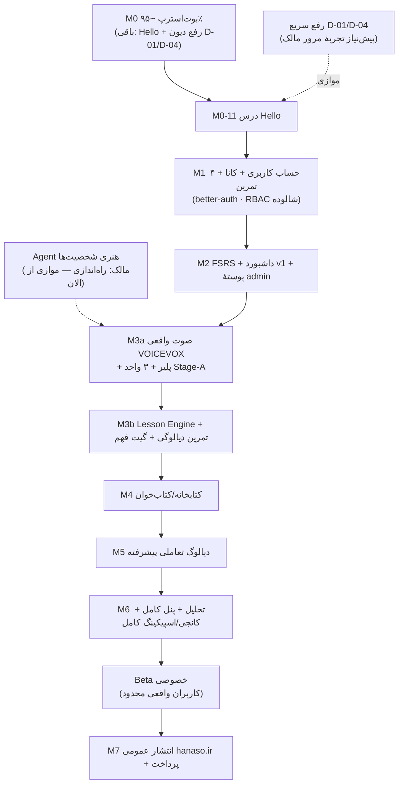

# HANASO Master Roadmap — از وضعیت واقعی تا Beta و Release

> **تاریخ:** ۲۰۲۶-۱۱-۰۳ · **مبنای نگارش:** Repository واقعی در `main = eb80e88` + ممیزی TASK-OPS-01 (Integration/DB/UI/Skills). این سند جایگزین اجرایی نقشهٔ کلی `ROADMAP.md` (سطح فاز) برای برنامه‌ریزی تسک‌به‌تسک است؛ آن سند مرجع فازها باقی می‌ماند.
> **قاعدهٔ صداقت:** هر وضعیت با شاهد کد/تست/deploy ثبت شده است. پژوهش KB ≠ قابلیت محصول.

## ۰. تصویر وابستگی Milestoneها

## ۱. وضعیت حوزه‌ها (A–P مأموریت) و ترتیب اجرایی

ترتیب اجرایی = ترتیب جدول (بر پایهٔ وابستگی واقعی، نه ترتیب الفبایی مأموریت).

### مرحلهٔ ۰ — تسک‌های آزادِ فوری (همین هفته، موازی)

| ID            | تسک                                                                                                                                | وضعیت   | پیش‌نیاز | Agent مناسب | Skillها (از ماتریس)                                 | فایل‌ها                               | تست پذیرش                                        | DoD                                  |
| ------------- | ---------------------------------------------------------------------------------------------------------------------------------- | ------- | -------- | ----------- | --------------------------------------------------- | ------------------------------------- | ------------------------------------------------ | ------------------------------------ |
| **OPS-01-Q1** | تولید صدا در build داکر (D-01): افزودن `pnpm gen:audio` به `infra/docker/Dockerfile` + ادعای smoke مسیر `/poc-audio/manifest.json` | `READY` | —        | Builder     | devops-deployment · quality-gates                   | Dockerfile · smoke.sh                 | compose-smoke سبز + manifest 200 در استقرار بعدی | merge + deploy + تأیید 200 روی دامنه |
| **OPS-01-Q2** | پاک‌سازی متن فنی UI (D-04): پنهان‌سازی فوتر فنی `/poc/dialogue` و گیت‌گذاری `/poc/t2-eval`                                         | `READY` | —        | Builder     | frontend-engineering · design-system-implementation | dialogue-scene.tsx · t2-eval/page.tsx | unit + مرور بصری فوتر                            | merge (بدون deploy اجباری)           |

### M0 — تکمیل بوت‌استرپ

| ID                                                 | تسک                        | وضعیت                  | باقی‌مانده                                  | پیش‌نیاز        | Agent             | تست‌ها                           | AC                                                 |
| -------------------------------------------------- | -------------------------- | ---------------------- | ------------------------------------------- | --------------- | ----------------- | -------------------------------- | -------------------------------------------------- |
| TASK-M0-11                                         | درس نمونهٔ «Hello» با ruby | `READY` (زیرساخت کامل) | محتوای درس + صفحهٔ درس واقعی + اتصال پیشرفت | M0-09 ✓ M0-10 ✓ | Builder + محتوایی | unit + integration + مرور مرورگر | AC-901..903 · FT-002/003 · قابل مشاهده روی Preview |
| (تسک اصلی بعدی — جزئیات: `NEXT_EXECUTION_TASK.md`) |                            |                        |                                             |                 |                   |                                  |                                                    |

**خروجی M0 = اولین تجربهٔ کامل «درس» برای مرور مالک.**

### M1 — تجربهٔ یادگیری اول (اولین گره بحرانی محصول)

| ID         | تسک                                                                 | وضعیت               | پیش‌نیاز                                       | Agent              | Skillها                                                       |
| ---------- | ------------------------------------------------------------------- | ------------------- | ---------------------------------------------- | ------------------ | ------------------------------------------------------------- |
| TASK-M1-01 | احراز هویت better-auth (ثبت‌نام/ورود/بازیابی) + جایگزینی `poc-user` | `READY` پس از Hello | M0-11 · تصمیم ارائه‌دهندهٔ ایمیل (OQ مالک #35) | Builder (backend)  | security-privacy · backend-engineering · systematic-debugging |
| TASK-M1-02 | آنبوردینگ + انتخاب سطح                                              | BLOCKED روی M1-01   | —                                              | Builder (frontend) | frontend-engineering · frontend-design                        |
| TASK-M1-03 | کانا (هیراگانا/کاتاکانا) + ۴ تمرین پایه                             | `READY` پس از M1-01 | روش تدریس مصوب (تحقیق آموزشی مالک)             | Builder + محتوایی  | learning-experience-implementation · test-driven-development  |
| TASK-M1-04 | IME/ورودی ژاپنی                                                     | بعد از تمرین‌ها     | —                                              | Builder            | bilingual-rtl-ltr                                             |
| TASK-M1-07 | شالودهٔ امنیتی پنل (RBAC skeleton)                                  | موازی با M1-03      | ADR-017                                        | Builder (backend)  | security-privacy · stride-analysis-patterns                   |

**ریسک‌ها:** تصمیم ایمیل (مالک) · حجم محتوای کانا (وابسته به روش تدریس) · مهاجرت دادهٔ `poc-user`.

### M2 — تکرار هوشمند

FSRS واقعی (ts-fsrs موجود است، wrapper آزمایشی در ماژول) + صف مرور + داشبورد v1 + پوستهٔ `/admin`. وابسته: M1. ریسک: طراحی صف/اولویت با محتوای واقعی.

### M3a — صوت واقعی (VOICEVOX)

پلیر و خطایابی صوت **موجود و تست‌شده‌اند** (T1 سبز)؛ اینجا تولید واقعی دو-کاناله (Opus+m4a طبق ADR-009) روی VPS/Worker + ۳ واحد محتوایی Stage-A. **وابسته به تصمیم مالک: مجوز VOICEVOX (#61) و بنچ روی VPS.** موازی: شخصیت‌ها (Agent هنری مستقل — از الان قابل شروع؛ گیت تأیید طرح مالک #50).

### M3b — Lesson Engine + Mastery

موتور درس متصل به محتوا + تمرین‌های دیالوگی + گیت فهم (`understood`). چرخهٔ A→D هم‌اکنون به‌صورت PoC کامل است — اینجا به محصول تبدیل می‌شود (چند واحد، محتوای واقعی، درس از دل محتوا).

### M4 کتاب‌خوان → M5 دیالوگ تعاملی → M6 تحلیل+پنل+کانجی/اسپیکینگ → Beta → M7 انتشار

طبق `ROADMAP.md` فازها؛ جزئیات تسک‌ها در ابتدای هر فاز شکسته می‌شود (قاعدهٔ تسک‌سازی موجود).

### حوزه‌های پژوهشی که «قابلیت» حساب نمی‌شوند (تا پیاده‌سازی شوند)

- **I کانجی Reading:** KB کامل (پداگوژی/On-Kun/پیشرفت) — 🔴 صفر کد.
- **J کانجی Writing:** KB + یک prototype HTML در ریپوی KB — 🔴 صفر کد در محصول.
- **K Speaking:** KB (پداگوژی/ضبط/مقایسه) — 🔴 صفر کد.
- **N تحلیل:** فقط sink رویداد PoC.
- **O Admin:** فقط blueprint KB.

همه در M6 یا پس از آن، طبق وابستگی.

## ۲. جدول وضعیت خلاصهٔ همهٔ حوزه‌ها (§۶ مأموریت)

| حوزه                           | وضعیت                                                                                     | کلاس                                                     |
| ------------------------------ | ----------------------------------------------------------------------------------------- | -------------------------------------------------------- |
| A Platform Foundation          | زیرساخت کامل CI/CD/deploy/monorepo                                                        | `DONE_VERIFIED`                                          |
| B Design System & Aizen        | توکن‌ها/فونت/کامپوننت/امضاها + در `/poc/ui` مرجع؛ اعمال یکنواخت ناقص                      | `DONE_VERIFIED` (سیستم) / `IN_PROGRESS` (اعمال در صفحات) |
| C Core Product Architecture    | معماری ماژولار + استقرار زنده                                                             | `DONE_VERIFIED`                                          |
| D Educational Content Contract | قرارداد اسکیما/seed یک-دیالوگ؛ registry کامل 🔴                                           | `IN_PROGRESS`                                            |
| E Lesson Engine                | PoC درس سطح B                                                                             | `PROTOTYPE`                                              |
| F Dialogue Experience          | پخش‌کنندهٔ قوی + خطایابی؛ محتوا ۱ واحد                                                    | `PROTOTYPE` (فنی قوی)                                    |
| G Vocabulary & Grammar         | در seed محدود                                                                             | `PROTOTYPE`                                              |
| H Exercises & Assessment       | ۶ نوع تمرین + ارزیابی سروری                                                               | `PROTOTYPE`                                              |
| I/J Kanji Reading/Writing      | فقط پژوهش KB                                                                              | `DEFERRED` (M6)                                          |
| K Speaking                     | فقط پژوهش KB                                                                              | `DEFERRED` (M6)                                          |
| L Audio Pipeline               | پلیر/مدیریت خطا ✓؛ تولید صدا placeholder (و در prod 🔴 تولید نمی‌شود — D-01)؛ VOICEVOX 🔴 | `IN_PROGRESS`                                            |
| M FSRS                         | ts-fsrs + wrapper آزمایشی                                                                 | `READY` (پیاده‌سازی در M2)                               |
| N Learning Analytics           | sink رویداد PoC                                                                           | `DEFERRED` (M6)                                          |
| O Admin & Content Ops          | blueprint فقط                                                                             | `DEFERRED` (M6)                                          |
| P Security/QA/Beta             | ۱۸۳ تست · ممیزی مخرب PRها · smoke زنده؛ auth/RBAC/E2E 🔴                                  | `IN_PROGRESS`                                            |

## ۳. تصمیم‌های باز مالک (گیت‌های تصمیم — از ممیزی این مأموریت)

| #   | تصمیم                                                               | مرحلهٔ تأثیر | فوریت                       |
| --- | ------------------------------------------------------------------- | ------------ | --------------------------- |
| 1   | راه‌اندازی Agent هنری شخصیت‌ها (#39..45) + تأیید نهایی طرح‌ها (#50) | M3a          | **الان** (طولانی‌ترین مسیر) |
| 2   | دسترسی S3 برای بکاپ خارج از سرور (D-03)                             | هر زمان      | بالا                        |
| 3   | ارائه‌دهندهٔ ایمیل تراکنشی (#35)                                    | M1           | متوسط (تا M1)               |
| 4   | مجوز VOICEVOX (#61)                                                 | M3a          | متوسط                       |
| 5   | حذف `/opt/genesis-learn` قدیمی (۱۱۴MB)                              | عملیات       | کم                          |
| 6   | Branch Protection (GitHub Pro ~$4/ماه) (#2)                         | حاکمیت       | اختیاری                     |
| 7   | درگاه پرداخت ریالی (#31)                                            | M7           | دیرهنگام                    |

## ۴. قواعد اجرا

- **موازی‌سازی مجاز** فقط با قرارداد تثبیت‌شده (schema/API/tokens) و اعلام هم‌نقطه در `AGENT_PROGRESS.md`.
- هر PR: جدول «Skills used» اجباری (پس از PR #76) + CI سبز + بازبینی مستقل.
- پیش از هر تسک: Preflight طبق `SKILL_SELECTION_MATRIX.md` (۲–۴ Skill مرتبط، نه همه).
- Deploy فقط با تغییر کد محصول (مستندات deploy نمی‌خواهد — قاعدهٔ §۱.۱ این ممیزی).

---

**تسک اجرایی بعدی (یک‌تا):** [`NEXT_EXECUTION_TASK.md`](./NEXT_EXECUTION_TASK.md) — **TASK-M0-11 درس Hello**
